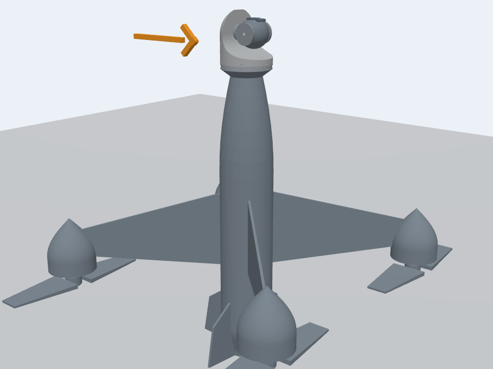
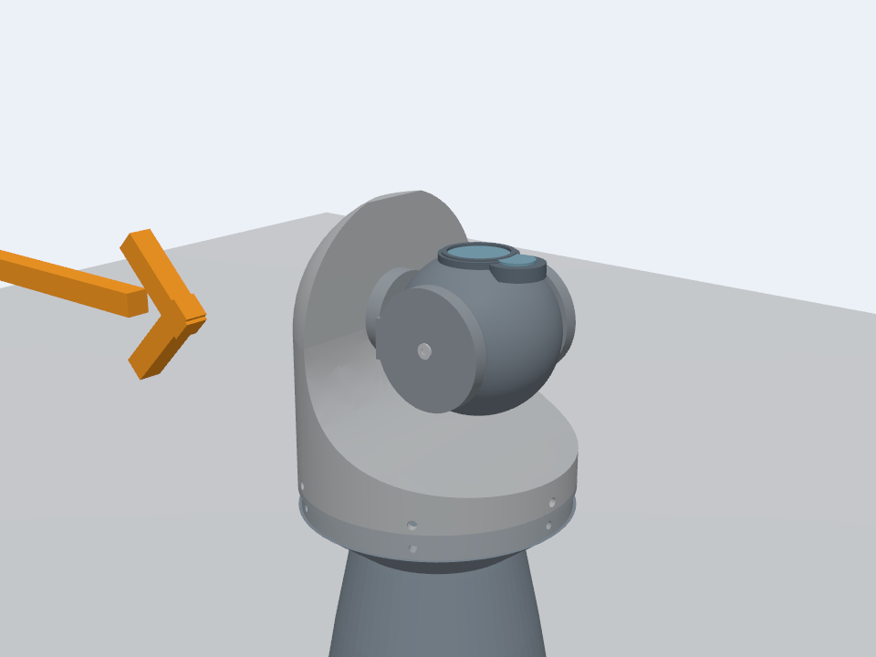
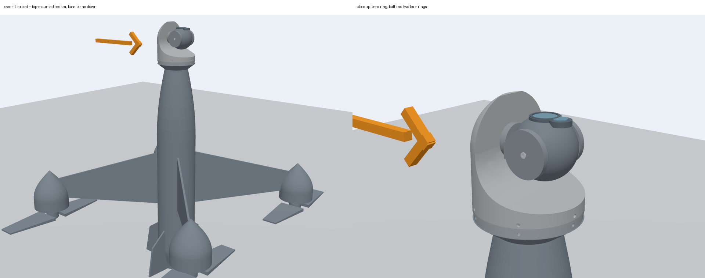

# 火箭穿越机与顶部艾晟导引头

`rocket_aisheng_seeker` 是独立装配模型：590 mm 火箭穿越机顶部安装 ASD-2-075-DD0 两轴导引头。导引头以**底座平面朝下**坐在机头顶部替换切口，底环水平，零位光轴朝上；前视靠 `pitch=-80°`，约高于水平面 10°。静态装配已确认，当前同时提供静态造型模型和带 PX4 动力接口、真实两轴关节、双相机的动态装配。

## 当前状态

- 由 `models/vehicles/rocket_racing_quad` 与 `models/gimbals/aisheng-ASD-2-075-DD0` 的当前原生资产组合。
- 原 `rocket_racing_quad`、`rocket_two_axis_pod` 和导引头基础模型均未修改；本装配独立生成。
- 火箭总长保持 590 mm；导引头底环安装面 `z=289 mm`，导引头高 91 mm，组合最高点 `z=380 mm`。
- 导引头保留原镜头和下方第二镜圈；底环 Ø84 mm、球头 Ø48 mm、机身最大 Ø90 mm。
- 静态 `model.sdf` 含 26 个 visual、无碰撞体、无关节、无插件；机身裁切网格保存在 `meshes/fuselage_cut.stl`。
- 动态装配质量 5.00 kg，PX4 airframe 4024；固定 `pod_mount_joint` 连接机体与导引头，两轴为真实关节，控制器显式设置 `mount_dynamic=true`。
- 动态话题默认 `/rocket_aisheng_seeker/{command,telemetry,command_result,image,image_tele}`；02 场景生成时改为 `/uav_<id>/pod/*`。
- 顶部为底座平面安装，因此零位视线朝上，前视时 yaw 水平效果受限；这是按现有 `rocket_two_axis_pod` 装配方式确认的结构。

验证结果见[装配验证](docs/validation.md)。

## 预览图







导引头旁橙色箭头为 `ROCKET_AISHENG_SEEKER_LOCATION_MARKER`，无碰撞体。

## 静态预览

在仓库根目录执行：

```bash
# 整机
sh assembledmodels/rocket_aisheng_seeker/tests/run.sh overall

# 导引头近景
sh assembledmodels/rocket_aisheng_seeker/tests/run.sh close

# 指定 yaw/pitch 姿态（仅静态视觉，不加载控制）
sh assembledmodels/rocket_aisheng_seeker/tests/run.sh close 45 -45
```

启动器每次生成独立 `/tmp/rocket-aisheng-seeker.*` 运行副本和 Gazebo 分区。整机实体 `ROCKET_AISHENG_SEEKER` 位于 `(0,0,0.225) m`，尾端离地 15 mm；安装面世界 `z=0.514 m`、最高点 `z=0.605 m`。浏览相机近裁剪 0.005 m，鼠标灵敏度 0.1；近景缩放请把鼠标放在实体表面，右键缓慢拖动微调。

## 动态装配

生成动态装配和 PX4 运行配置：

```bash
python3 assembledmodels/rocket_aisheng_seeker/tools/generate_dynamic_model.py \
  --output-dir assembledmodels/rocket_aisheng_seeker/runtime/rocket_aisheng_seeker
```

生成目录包含 `model.sdf`、`model.config`、`parameters.json`、`manifest.json`、`px4/4024_gz_rocket_aisheng_seeker`、测试世界和全部引用网格。`runtime/` 不提交入库，重新生成即可。

动态模型继承基础火箭机的质量、惯量、动力和 PX4 参数，叠加导引头原生质量；两轴限位 yaw ±60°、pitch −80°～+30°，机械速度上限 60°/s。导引头控制器为复制后的 `gz-aisheng-seeker-controller`，支持广角/长焦双相机和 `sim_truth` 跟踪。

### 独立飞行验收

```bash
bash assembledmodels/rocket_aisheng_seeker/tests/run_flight_check.sh headless
```

入口使用 `PX4_ROOT`（默认 `/home/zs/test/PX4-Autopilot`）和 `FLIGHT_PYTHON`，生成全新运行副本，执行 IMU 等待、PX4 SITL 起飞、悬停、巡航、冲刺、降落及稳定性分析。结果路径在启动时打印；依赖 `pymavlink`、`pyulog` 和 Gazebo Python 绑定。

### 02 场景

在 PX4 仓库执行：

```bash
bash scenarios/02_rocket_two_axis_pod/start.sh --aircraft-model rocket_aisheng_seeker
```

场景默认仍使用 `rocket_two_axis_pod`，不指定参数时行为不变。选择导引头后，场景使用本目录生成器、导引头控制器、二进制 UDP/RTP 网关和导引头地面站；首机控制 UDP 8770、二进制遥测 8800、PX4 JSON 9000、广角 RTP 7001、长焦 RTP 7002。网关把内部遥测转换为 `dyt_udp_bridge` 期望的 19 字段 JSON，以 50 Hz 发往本机对应端口。

## 重新生成与检查

```bash
python3 assembledmodels/rocket_aisheng_seeker/tools/generate_model.py
python3 -m unittest discover -s assembledmodels/rocket_aisheng_seeker/tests -p 'test_*.py'
```

生成器读取火箭和导引头的当前 SDF/网格，裁切机身顶部并放置导引头；不要手工修改 `model.sdf`、`model.config`、`tests/world.sdf`、`tests/closeup.sdf` 或 `meshes/fuselage_cut.stl`。

## 文件

- `model.sdf`、`model.config`：生成的静态装配模型。
- `meshes/fuselage_cut.stl`：从火箭基础机身实际网格裁切得到的机身段。
- `parameters.json`：静态参数、动态 airframe/话题、PX4 参数和稳定性门限。
- `tools/generate_model.py`：静态装配生成器。
- `tools/generate_dynamic_model.py`：动态装配与 PX4 运行配置生成器。
- `tools/pod_kinematics.py`：从导引头 SDF 读取两轴运动链。
- `tools/render_views.py`：离线评审图工具（需要 Matplotlib；当前预览图由 Gazebo overview 相机生成）。
- `tools/analyze_flight_stability.py`：完整飞行 ULog 与导引头姿态稳定性分析。
- `tools/capture_gimbal_telemetry.py`：只读保存导引头姿态遥测。
- `tests/run.sh`：Gazebo GUI 静态预览入口。
- `tests/test_appearance.py`：原生几何继承、裁切闭合、安装面、两轴机械角和再生成一致性检查。
- `tests/test_dynamic_model.py`：动态装配结构、质量、话题、相机、PX4 机体和网格检查。
- `tests/run_flight_check.sh`：独立 PX4 飞行验收入口。
- `tests/results/flight_result.json.gz`、`flight_stability.json`：当前完整飞行与稳定性归档。
