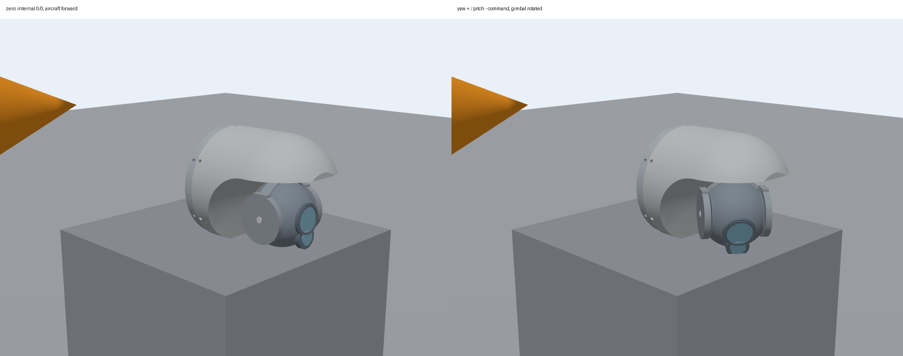
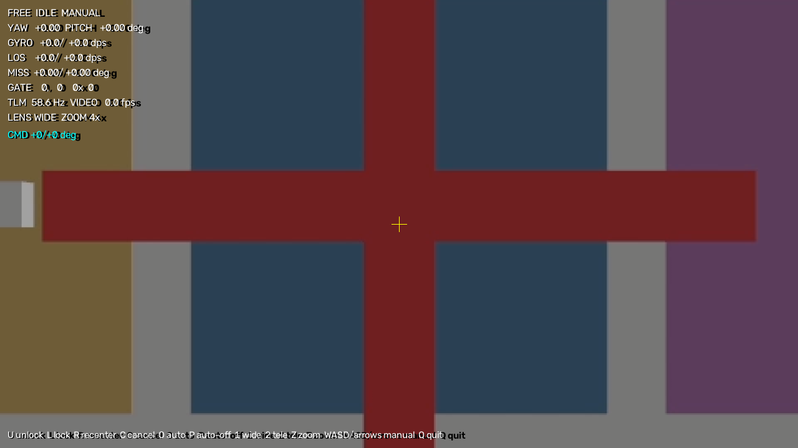
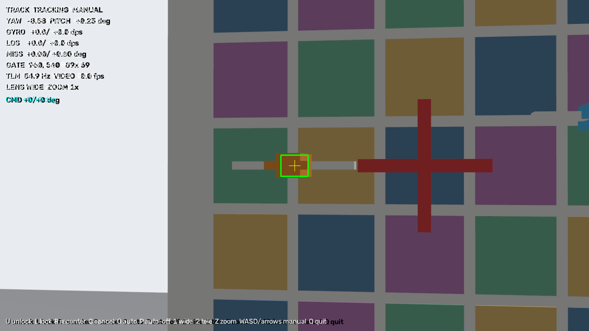
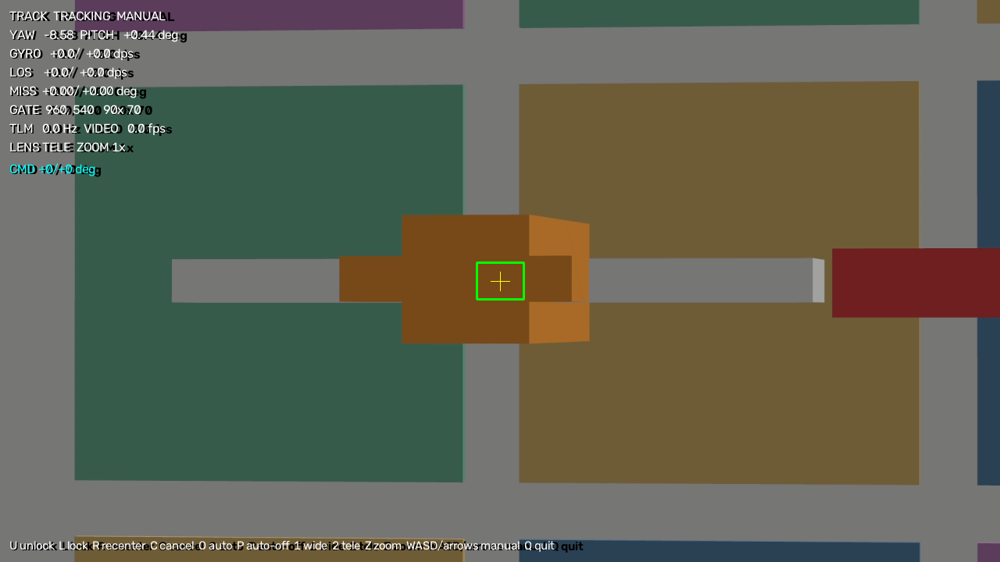
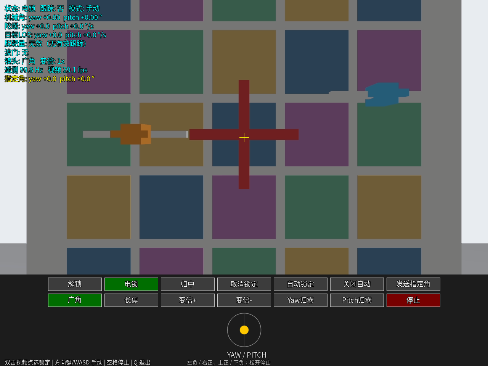

# ASD-2-075-DD0 两轴导引头仿真组件

本目录提供 ASD-2-075-DD0 两轴导引头的 Gazebo 模型、标准二进制 UDP 网关、RTP 双路视频和配套上位机。当前已实现：

- 复制 `two_axis_pod` 的壳体、球头和两轴机械结构，原 `two_axis_pod` 不动；
- 内部机械零位朝上、整机绕 Y 轴 +90° 安装后的前视两轴运动；
- 每轴 60°/s、yaw ±60°、pitch −80°～+30° 的运动范围和限位；
- 广角 38°×22°、长焦 12.7°×7° 双路相机；模型为 1920×1080，演示默认以 1280×720@30 输出；
- 标准 45 字节控制帧 / 104 字节遥测帧，UDP 100 Hz；
- 可选 50 Hz 19 字段 PX4 JSON 转发，供 `dyt_udp_bridge` 发布 `dyt_aisheng_telemetry`；
- 上位机 RTP 双路视频、遥测显示、双击点选锁定、自动锁定最近中心飞机、取消锁定、电锁/解锁、归中、指定框架角和手动转动。

当前不实现目标检测/识别、视频 SEI、红外、激光测距、地理跟踪、OSD、存储、除雾、图像增强、IP 设置和陀螺校准；演示目标飞机默认静态，可用 `tests/move_target.py` 或 `run_demo.sh --move` 运动；数字变焦已在上位机显示端实现。

## 外观图



左侧为内部机械 0/0（整机安装后朝载机前方）；右侧为发送 yaw 正、pitch 负速度指令后的实际转动。






上位机正在用广角跟踪 `target_aircraft`：绿色框为跟踪框，目标已居中，左上角显示标准遥测转换后的框架角、角速度、失调角、波门和接收速率。



上位机切换到长焦后的原生跟踪画面：`LENS TELE`、目标居中、跟踪框约 90×70 px。



视频下方为命令按钮和 yaw/pitch 虚拟摇杆；左上角显示中文遥测、脱靶量和波门状态。

## 模型来源与边界

- 壳体、球头、镜框和两轴结构来自 `models/gimbals/two_axis_pod` 的当前网格；本目录复制后修改，**原 `two_axis_pod` 完全不动**。
- 首版沿用两轴包络：约 Ø84 mm×91 mm、0.24 kg；产品规格为 Ø75 mm×84.5 mm、≤230 g，外观和包络差异已记录。
- 产品为后部法兰、前部球罩双镜头；本组件沿用两轴吊舱的圆环底座，并在原镜头下方增加了一个纯视觉长焦镜圈（`tele_lens_barrel_visual` / `tele_lens_window_visual`）。长焦相机传感器与第二镜圈对齐；镜圈无碰撞、无质量，不改变机械结构。第二镜圈的位置、尺寸和间距已确认。

## 坐标、零位与安装

内部机械约定沿用 `two_axis_pod`：

```text
R_mount_gimbal = Rx(yaw) Ry(-pitch)
los_mount = (-sin(pitch), -sin(yaw)cos(pitch), cos(yaw)cos(pitch))
```

- pod 内部零位：光轴沿本地 +Z，即吊舱自身“朝上”。
- pod 内部 pitch 负值转向本地 +X；pitch=-90° 时沿本地 +X。
- yaw 范围 ±60°，pitch 范围 −80°～+30°，每轴限速 60°/s。
- 组件整机绕 Y 轴 +90° 安装：pod 本地 +Z 对准载机 +X。因此**载机坐标中的前视对应内部机械 pitch=0°**；内部 pitch 正值朝载机上方，负值朝载机下方。产品框架角（前视 0/0、pitch 上正下负、yaw 右正左负）与内部机械角同号，协议直接使用。
- 这样安装后 yaw 轴在载机坐标中变为垂直轴，前视时 yaw 可以正常左右转；不会出现“内部 pitch=-90° 时光轴与 yaw 轴重合”的奇异。

## 双路相机

- `camera`：广角，1920×1080@30 Hz，水平视场 38°，垂直约 22°，位于原镜头位置。
- `camera_tele`：长焦，1920×1080@30 Hz，水平视场 12.7°，垂直约 7°，位于原镜头下方的第二镜圈位置，光轴与广角平行。
- 两路传感器都在 `camera_link` 上；网关用 NVENC 编码为 H.264 RTP over UDP，上位机用 NVDEC 解码显示。
- 图像话题：`/aisheng_seeker/camera`、`/aisheng_seeker/camera_tele`；外部观察相机话题 `/aisheng_seeker/overview`。
- 上位机可切换广角/长焦显示；网关同时通知插件切换活动相机。双击/自动锁定使用当前活动镜头的像素和真值候选，跟踪控制使用该镜头的内参和光轴，长焦可原生独立跟踪。
- 变焦 +/- 更新遥测状态位；上位机按 1×/2×/4× 对广角画面做中心裁剪和缩放，RTP 流本身仍为全视场。

## 标准二进制 UDP 与视频

网关 `gateway/main.py` 在 Gazebo 插件 JSON 话题和标准二进制 UDP 之间转换：

| 项目 | 默认值 |
|---|---|
| 控制 UDP | `0.0.0.0:8790` |
| 遥测 UDP | 发往 `127.0.0.1:8791` |
| 广角 RTP | `127.0.0.1:7001` |
| 长焦 RTP | `127.0.0.1:7002` |
| PX4 JSON | 默认关闭；`--px4-json-port` 指定后 50 Hz 发往 `127.0.0.1:<port>` |
| 控制帧 | 45 字节，帧头 `0xAA55`，长度 `0x2D` |
| 遥测帧 | 104 字节，帧头 `0x55AA`，长度 `0x68` |
| 遥测周期 | 100 Hz |
| 校验 | 字节 4 起求和取低 8 位 |

已实现控制命令：

- `0xE9` 框架电锁、`0x9E` 电锁解除；
- `0x90` 指定框架角度、`0x14` 指定角度并电锁、`0x91` 归中；
- `0xB7` 点选目标锁定（像素 x/y）；
- `0x5F` 自动锁定、`0xF5` 关闭自动锁定；
- `0x8E` 取消锁定；
- `0xB1` 框架移动（左右/上下 −100～+100，映射到 ±60°/s）；
- `0xB9/0x9B` 变焦状态；
- `0x53` 切换激活镜头（参数 1 广角、2 长焦，仿真映射）。

标准遥测中的陀螺角速度、视线角速度和失调角按协议字段范围限幅 ±20°/s；实际 60°/s 机械转速保留在 Gazebo 插件 JSON 遥测中，不塞进标准字段。

网关可用 `--image-topic`、`--tele-image-topic` 覆盖图像话题，默认 `<topic-prefix>/camera` 和 `<topic-prefix>/camera_tele`。显式指定 `--px4-json-port` 后，网关按 50 Hz 把内部遥测转换为 `dyt_udp_bridge` 期望的 19 字段 JSON，时间戳在发送前生成；默认关闭，不影响独立演示。字段映射、±20°/s 限幅和无效目标置零规则见 `gateway/px4_forward.py`。

自动锁定使用 Gazebo 插件发布的 `truth_candidates`（当前广角相机内已注册飞机投影中心），选择离画面中心最近的一架；点选锁定选择点击位置附近最近的候选。两种锁定都通过内部 `track` 框启动插件的 `sim_truth` 单目标跟踪，不使用 YOLO 或纹理跟踪。自动锁定在目标丢失后会重新选择当前最近中心飞机。

RTP 视频使用 H.264、payload 96、`config-interval=1`、`mtu=1400`；接收端 `rtpjitterbuffer latency=0`，面向局域网低延迟。产品文档的“UDP 裸流”在仿真中由 RTP over UDP 实现，差异已在组件文档记录。完整帧表、命令参数和限制见[协议与接口](docs/protocol.md)。

## 运行

在仓库根目录执行：

```bash
# 首次或修改 controller 后构建
cmake -S models/gimbals/aisheng-ASD-2-075-DD0/controller \
  -B models/gimbals/aisheng-ASD-2-075-DD0/controller/build \
  -DCMAKE_BUILD_TYPE=Release -DBUILD_TESTING=OFF
cmake --build models/gimbals/aisheng-ASD-2-075-DD0/controller/build -j4

# 完整演示：Gazebo GUI + 二进制网关 + RTP 双路视频 + 上位机
bash models/gimbals/aisheng-ASD-2-075-DD0/tests/run_demo.sh

# 不打开 Gazebo GUI，只保留上位机视频/遥测
bash models/gimbals/aisheng-ASD-2-075-DD0/tests/run_demo.sh --headless

# 同时让 target_aircraft 按默认航线运动
bash models/gimbals/aisheng-ASD-2-075-DD0/tests/run_demo.sh --move

# 保存一张包含底部控制面板的上位机截图后继续运行
bash models/gimbals/aisheng-ASD-2-075-DD0/tests/run_demo.sh --headless \
  --snapshot /tmp/aisheng_gcs_ui.png

# 覆盖演示视频分辨率（默认 1280x720@30）
AISHENG_VIDEO_WIDTH=1920 AISHENG_VIDEO_HEIGHT=1080 \
  bash models/gimbals/aisheng-ASD-2-075-DD0/tests/run_demo.sh --headless

# 仅外观/转动预览，并自动做 30 s 两轴扫掠
bash models/gimbals/aisheng-ASD-2-075-DD0/tests/run_preview.sh

# 只看模型，不自动扫掠
bash models/gimbals/aisheng-ASD-2-075-DD0/tests/run_preview.sh --no-sweep

# 25°/s 视线角速度验收（自动启动动态目标世界和网关）
bash models/gimbals/aisheng-ASD-2-075-DD0/tests/run_los25.sh
```

上位机界面参考两轴吊舱地面站：视频下方是命令按钮和 yaw/pitch 虚拟摇杆，视频左上角显示中文遥测，顶部滑条用于指定框架角。

- 底部按钮：`解锁`、`电锁`、`归中`、`取消锁定`、`自动锁定`、`关闭自动`、`发送指定角`、`广角`、`长焦`、`变倍+`、`变倍-`、`Yaw归零`、`Pitch归零`、`停止`；
- 底部虚拟摇杆：左负 yaw、右正 yaw，上正 pitch、下负 pitch，每轴最大 20°/s，松开鼠标停止；键盘 `W/A/S/D` 或方向键为 60°/s 点动；
- 双击视频画面：若当前电锁，先自动解锁，再按点击位置点选锁定；
- 快捷键：`U` 解锁，`L` 电锁，`R`/`H` 归中，`C` 取消锁定，`O` 自动锁定，`P` 关闭自动锁定，`1` 广角，`2` 长焦，`Z` 变倍+，`Shift+Z` 变倍-，空格停止，`Q` 或 Esc 退出；
- 顶部 `Yaw x0.1`/`Pitch x0.1` 滑条设置指定框架角，范围 −60.0°～+60.0°、−80.0°～+30.0°，步进 0.1°；点击 `发送指定角` 才下发，拖动滑条不连续改变框架。
- `Yaw归零`/`Pitch归零` 只把对应轴置零，另一轴保持当前机械角；电锁状态下会先自动解锁。

上位机视频显示 1280×720，窗口下方增加 240 px 控制面板；锁定框、遥测、镜头切换提示和命令提示叠加在视频上。

无界面自检（需要网关和 Gazebo 已启动）：

```bash
.venv-linux/bin/python models/gimbals/aisheng-ASD-2-075-DD0/ground_station/main.py \
  --selftest 5
```

自检检查遥测频率、双路视频解码和解锁后的自由状态；低渲染性能机器会显示频率警告但仍按最低 40 Hz 判定。

上位机默认读取 `ground_station/config.ini`，命令行参数可覆盖。保存当前连接/视频/镜头配置：

```bash
.venv-linux/bin/python models/gimbals/aisheng-ASD-2-075-DD0/ground_station/main.py \
  --host 127.0.0.1 --control-port 8790 --save-config
```

启动脚本会打印 `GZ_PARTITION`。在另一个终端用同一分区手动发送指令或移动目标：

```bash
export GZ_PARTITION=<启动脚本打印的分区>

# 让 target_aircraft 按默认航线运动 30 s
.venv-linux/bin/python models/gimbals/aisheng-ASD-2-075-DD0/tests/move_target.py \
  --duration 30
```

手动速度/回零/停止：

```bash
export GZ_PARTITION=<启动脚本打印的分区>

# yaw 以 30°/s 转 2 s，pitch 0；松手自动停车
.venv-linux/bin/python models/gimbals/aisheng-ASD-2-075-DD0/tests/command.py \
  manual 30 0 --duration 2

# 两轴回机械零位（载机前视）
.venv-linux/bin/python models/gimbals/aisheng-ASD-2-075-DD0/tests/command.py home

# 立即停止
.venv-linux/bin/python models/gimbals/aisheng-ASD-2-075-DD0/tests/command.py stop
```

手动指令是**角速度**，单位 °/s；`yaw` 右正、`pitch` 上正。持续发送由 `command.py` 的 `--duration` 控制，插件在 0.5 s 无新指令时自动停车。

## 观察入口与定位标志

- 实体名：`AISHENG_SEEKER`。
- 定位标志：`AISHENG_SEEKER_LOCATION_MARKER`，位于模型左前方约 `(-0.12, -0.28, 1.55) m`，橙色箭头指向导引头，默认无碰撞体，便于在场景中快速定位。
- 浏览相机初始近裁剪距离 0.005 m，启动脚本会尝试把鼠标灵敏度设为 0.1。滚轮缩放参考鼠标指向的三维位置；近景检查请把鼠标放在模型实体表面，再用右键缓慢拖动微调，避免指向远处背景导致一步跳过小部件。
- 如果灵敏度服务未就绪，可在同一分区手动执行：

```bash
gz service --service /gui/camera/view_control/sensitivity \
  --reqtype gz.msgs.Double --reptype gz.msgs.Boolean \
  --timeout 2000 --req 'data: 0.1'
```

## 演示世界

- `tests/preview.world.sdf` 由 `tools/generate_model.py` 生成，包含：
  - 固定在 1.46 m 台座上的导引头，整体绕 Y 轴 +90° 安装；
  - 前方 x=4 m 的 5×5 彩色靶墙和红色中心十字，用于观察广角/长焦视场和两轴转动；
  - 两架静态目标飞机 `target_aircraft`（橙白）和 `target_aircraft_2`（蓝白），位于靶墙前方，用于点选锁定和自动锁定最近中心飞机；
  - 橙色定位箭头 `AISHENG_SEEKER_LOCATION_MARKER`；
  - 外部观察相机 `/aisheng_seeker/overview`。
- 抓取一帧图像：

```bash
export GZ_PARTITION=<启动脚本打印的分区>
.venv-linux/bin/python models/gimbals/aisheng-ASD-2-075-DD0/tests/capture.py \
  --topic /aisheng_seeker/overview --output /tmp/aisheng_overview.png
```

## 文件

- `parameters.json`：包络、质量、机械限位、60°/s、广角/长焦相机参数、真值目标名和 LOS 观察点。
- `tools/generate_model.py`：从复制的 CAD 网格生成 `model.sdf` 和 `tests/preview.world.sdf`；修改参数后重新运行。
- `model.sdf`：生成的 Gazebo 模型，包含两轴、两个相机、真值目标配置和控制器。
- `controller/`：复制并改名的两轴控制器，库名 `gz-aisheng-seeker-controller`，机械速度硬上限 60°/s；遥测增加 `truth_candidates` 和图像宽高；原 `two_axis_pod` 控制器不变。
- `common/protocol.py`：标准 45/104 字节帧编解码、校验和、比例尺和限幅。
- `gateway/main.py`：二进制 UDP 网关、命令映射、点选/自动锁定、100 Hz 遥测。
- `gateway/px4_forward.py`：内部 JSON → 19 字段 PX4 艾晟 JSON，含 UDP 发送器。
- `gateway/video_worker.py`：单路相机独立编码进程；网关为广角/长焦各启动一个，避免两路 1080p 图像争用 Python GIL。
- `gateway/video_tx.py`：Gazebo 图像 → NVENC H.264 → RTP over UDP。
- `ground_station/main.py`：RTP 双路视频、中文遥测、双击锁定、自动锁定、命令按钮、虚拟摇杆、指定角滑条和无界面自检。
- `ground_station/config.ini`：上位机网络、视频端口、启动镜头和镜头切换开关配置。
- `tests/run_demo.sh`：完整演示入口。
- `tests/run_preview.sh`：仅外观/转动预览入口。
- `tests/sweep.py`：自动两轴速度扫掠。
- `tests/command.py`：手动速度/回零/停止指令。
- `tests/capture.py`：保存 Gazebo 相机图像。
- `tests/move_target.py`：用 Gazebo `set_pose` 服务移动目标飞机，验证动态真值跟踪。
- `tests/check_binary.py`：二进制协议/运动回环检查。
- `tests/check_lock.py`：点选锁定/自动锁定/取消锁定/电锁回环检查。
- `tests/check_tele.py`：长焦原生点选锁定回环检查。
- `tests/check_limits.py`：两轴手动速度、限位和峰值速度回环检查。
- `tests/check_los25.py`：25°/s 视线角速度跟踪验收。
- `tests/run_los25.sh`：启动 `los25.world.sdf`、网关并执行 25°/s 验收。
- `tests/los25.world.sdf`：由生成器输出的动态目标世界，目标运动插件平滑移动 `target_aircraft`。
- `controller/src/target_motion.cc`：演示目标运动插件，按物理步设置目标位姿。
- `tests/test_protocol.py`：协议编解码单元测试。
- `tests/test_coordinates.py`：广角/长焦像素换算单元测试。
- `tests/test_px4_forward.py`：19 字段转换、限幅、无效目标和 UDP 回环测试。
- `tests/test_gcs_ui.py`：按钮布局/命中、摇杆死区、命令映射、双击点选和单轴归零测试。

## 当前验证

- 控制器已构建，演示世界启动后插件发布 `/aisheng_seeker/telemetry`，遥测中 `mount.quat_world` 为绕 Y 轴 +90°，`los_mount` 在模型内部为 +Z，外部相机沿载机 +X 前视。
- 标准二进制网关回环：遥测 100.3 Hz、校验错误 0；解锁、指定角度、归中、手动框架移动均能改变机械角并回传。
- 点选锁定 `target_aircraft` 成功，跟踪框约 90×70 px；导引头 yaw/pitch 自动转到目标居中，静态目标失调角收敛到 0。
- 自动锁定选择离画面中心最近的 `target_aircraft`；取消锁定、关闭自动锁定和框架电锁均回传正确伺服状态。
- 用 `tests/move_target.py` 的默认航线（3.7 m 距离，y ±0.30 m、z ±0.12 m）移动目标时，129/129 个稳态采样保持 TRACK，峰值失调角 1.97°。
- `tests/los25.world.sdf` 的目标运动插件以约 26.7°/s 峰值平滑移动目标；25°/s 验收 100/100 稳态 TRACK，内部 `target_los` 峰值 26.21°/s，标准帧 LOS 按协议限幅到 20.00°/s，最大失调角 0.18°。跟踪使用目标 LOS 角速度前馈，前馈限幅 ±30°/s。
- 自动锁定跟踪中把目标移出视场，插件进入 LOST；目标移回后自动锁定重新选择并恢复 TRACK。
- 上位机 10 Hz 心跳；停止心跳 2 s 后网关停止跟踪并保持角度，控制超时保护已回环验证。
- 广角、长焦 RTP 视频在 7001/7002 端口有持续 H.264 包；上位机能解码显示广角/长焦、遥测、跟踪框和按键提示。
- 广角 1×/2×/4× 数字变焦已在上位机显示端验证，4× 画面为中心裁剪放大，`docs/zoom4.png` 为实际截图。
- 长焦原生点选锁定已验证：`camera.active=tele`、`tracking.state=TRACK`、跟踪框约 90×70 px，目标居中，失调角约 0。
- 框架最大转速 60°/s 已确认；yaw 正指令使机械角正向增加，pitch 负指令使机械角负向增加。`check_limits.py` 回环检查**框架角速度**峰值 60°/s，四个方向均未越过 yaw ±60°、pitch −80°～+30°。
- 规格书的“视线角速度 ±25°/s”与标准协议表的“±20°/s”存在字段范围差异：插件内部 `target_los` 保留实际值，标准遥测按协议字段限幅 ±20；25°/s 跟踪验收已通过，标准帧仍按协议发送 ±20。
- 无界面上位机自检可检查遥测、双路视频和解锁状态；当前 1280×720 演示下遥测 100 Hz、双路 30 fps，达到 30 fps 目标。
- 上位机操作界面已按两轴吊舱地面站补充底部命令按钮、yaw/pitch 虚拟摇杆、单轴归零、指定角和中文遥测；按钮布局/命中、摇杆死区、按钮命令、双击自动解锁点选、单轴归零和指定角 8 项单元测试通过，实际界面截图见 `docs/gcs_ui.png`。
- 19 字段 PX4 JSON 已回环验证：字段数 19、50 Hz、无效目标置零、gyro/LOS 限幅 ±20°/s、`los_omega_*` 不限幅；02 场景导引头路径已把该 JSON 送入 `dyt_udp_bridge`，PX4 `dyt_aisheng_telemetry` 可读到对应字段。
- 动态装配 `assembledmodels/rocket_aisheng_seeker/` 已验证 5.00 kg、airframe 4024、100 Hz 插件遥测、双相机话题和 PX4 机体生成；独立飞行验收见该装配目录。
- 尚未验证：更高机动/连续满速/极限限位碰撞、视频 SEI、多客户端控制。
