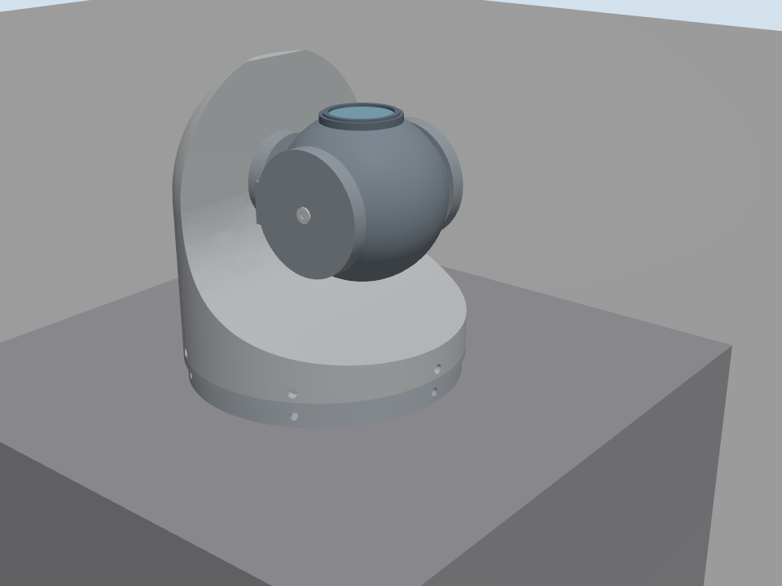

# 两轴立装吊舱

`two_axis_pod` 是独立的两轴立装相机组件，包含 Gazebo 模型、飞机目标检测与多目标跟踪、图像跟踪控制插件、UDP/RTSP 网关、地面站与固定立装演示。导引头以水平圆环为底部，一体闭合的内凹罩壳向上延伸，球形相机位于罩壳前方的双侧支架内。圆环直径 84 mm，整机高度 91 mm、底部以上主体高度 83 mm、底部圆面厚度 8 mm、相机球直径 48 mm，并表现 6×M3 孔位。三轴组件保持独立。



[内轴−80°时的实际镜片位置](docs/forward.png)。

## 安装与角度

本组件采用底座向下安装：Ø84 mm 底部圆环与地面平行，外罩位于圆环上方。安装系 +X 朝飞机前方、+Y 朝左、+Z 朝上，装配原点位于底部圆环后端面中心，整高 91 mm。CAD 原始坐标经 `diag(-1,-1,1)` 转到安装系，球头一侧朝安装 +X。装配时固定 `mount_link`；圆环、外罩和外轴轴承座固定，支架随外轴转动，球头、镜框和镜片随内轴转动。

- `yaw` 按镜头视线左负右正，为外轴机械角，绕安装系水平 +X 转动，范围 −60°～+60°；不能按绕竖直轴的航向角解释。
- `pitch` 为内轴机械角，绕随动 −Y 转动，范围 −80°～+30°。零位沿用 CAD 原始零位，光轴沿安装 +Z 朝天；外轴为零时，内轴负角将镜头转向安装 +X，−80° 时光轴高于安装水平面 10°。
- `reset`、`home` 回两轴机械 0°；`reset_axis` 回指定轴零位并保持另一轴的采样位置。
- 两条转轴在球心相交，零位球心为 `(0.015,0,0.056) m`，球心不随外轴公转。零位视线不退化；接近内轴 ±90° 时外轴视线控制能力下降，两轴没有第三轴提供画面水平稳定。

运动学、安装与覆盖范围见[安装说明](docs/mounting.md)。控制协议为 `protocol_version=7`、`angle_convention=motion_head_joint_right_positive`；字段 `yaw/pitch` 均表示机械轴，网关和地面站必须配套。相机图像仍按向右、向下为正定义脱靶量。

机载装配可通过插件 `mount_dynamic=true` 启用实际安装姿态更新和跟踪中的载机转动补偿；机械轴随载机变化，零位仍沿安装 +Z。组合模型的参数、质量估计与运行入口属于对应装配和场景目录，不改变本组件的固定立装演示。

## 构建与运行

在仓库根目录执行：

```bash
cmake -S models/gimbals/two_axis_pod/controller -B models/gimbals/two_axis_pod/controller/build
cmake --build models/gimbals/two_axis_pod/controller/build -j4
ctest --test-dir models/gimbals/two_axis_pod/controller/build --output-on-failure
bash models/gimbals/two_axis_pod/scripts/run_plugin_sim.sh
bash models/gimbals/two_axis_pod/scripts/run_bridge.sh
bash models/gimbals/two_axis_pod/ground_station/run.sh
```

Linux 网关和地面站启动时都会自动检查并安装缺失的运行依赖，共用仓库根目录 `.venv-linux`。网关额外在启动前实际加载归档 ONNX 并检查 NVENC；地面站读取带注释的 `ground_station/config.ini`。两者都无需预先执行安装命令。运行依赖与网络地址见[启动说明](scripts/README.md)、[网关说明](controller/service/README.md)和[地面站说明](ground_station/README.md)。演示世界不启动 PX4。相机为 1920×1080@30Hz、水平视场 60°。

地面站提供关闭视觉、目标检测、自动锁定和手动框选四个互斥模式。目标检测使用 `models/yolo11/aircraft_yolo11n/model.onnx` 的单类飞机模型；多目标轨迹默认连续命中 5 帧后确认，检测及自动搜索阶段的 RTSP 画面包含红框与稳定轨迹号。自动锁定首次选择离画面中心最近的已确认目标，然后停止多目标叠加并把该框交给 CSRT，地面站只显示一个绿色跟踪框；CSRT 最终丢失后恢复检测搜索。视频只允许 NVENC 编码和 NVDEC 解码，不提供软件回退。

地面站右上角可编辑 IP/端口，点击“发送艾晟报文/停止发送”控制仅含 9 个转换字段的 UDP JSON 输出，不发送完整状态原文。地址保存在 INI `[forward]`，发送默认关闭、频率跟随新收到的遥测。吊舱提供 `target.miss`：目标中心坐标、相对画面中心的像素和角度脱靶量及测量帧号，X 右正、Y 下正；跟踪无效时数值为 `null`。两轴机械转速统一限制为 ±20°/s，覆盖手动、回零、复位和跟踪。艾晟输出使用机械框架角、机械角速度和角度脱靶量的直接数值（度、度/秒），其中两轴角速度字段对称限幅到 ±20°/s；原始遥测保留实际测量。跟踪有效性占位置信度为 25.5 或 0.0，`target_confidence` 固定发送 0.8；用法和完整字段见[地面站说明](ground_station/README.md)，原始脱靶量定义见[控制协议](docs/control-protocol.md#跟踪脱靶量)。

## 参数与资料

- `parameters.json`：尺寸、机械限位、0.24 kg 总质量、安装运动学、最大速度/加速度与相机参数。
- `models/yolo11/aircraft_yolo11n/`：单类飞机 ONNX、类别、来源、许可、元数据与校验值。
- `controller/service/vision.json`：检测置信度、NMS、多目标确认/丢失参数和推理线程数。
- `cad/motion_head.step` 与同名 `.step.json`：毫米制原始精确实体及 CAD 两轴定义。
- `cad/properties.json`：九个网格的源哈希、分组、体积、边界和精确几何质量属性。
- `tools/import_cad.py`：使用 cadgen 0.7.26 从 STEP 导出九个米制 DAE 网格和质量属性；导入后无需外部工程目录。
- `tools/generate_model.py`：用标准 Python 从已导入资产和参数生成 `model.sdf`、`tests/world.sdf`。演示环境来自 `tests/world_base.sdf`，包含固定立装模型和朝天纹理靶标。
- [控制协议](docs/control-protocol.md)：机械角、命令与遥测约定。
- [验证说明](docs/validation.md)：验证命令、结果及限制。
- [演示与自测](tests/README.md)：演示世界与在线检查。
- [完整地理背景测试](../../../scenarios/geographic_two_axis_pod/README.md)：空中动态靶标、实体遮挡和地面站验证，不加载载机。

修改参数后在仓库根目录运行 `python3 models/gimbals/two_axis_pod/tools/generate_model.py` 并重新验证。控制插件直接读取模型中的限位参数；相机姿态和实际关节轴必须与安装说明一致。

更新 CAD 时运行 `uvx --no-config --managed-python --python 3.13 --from cadgen==0.7.26 python models/gimbals/two_axis_pod/tools/import_cad.py --source /path/to/motion_head.step`，再运行普通生成命令。源 STEP 与同名关节边车必须一致。生成器核验源和网格哈希，并拒绝与专用控制器不一致的转轴或光学基底。

外廓为 84/91/83 mm，球头直径 48 mm，六个径向 M3 孔以 Φ2.5 mm 底孔表达。未标尺寸及内部结构仍属几何估算。总质量按 0.24 kg，以九个已建模实体的统一有效密度分配并积分各 link 的重心和完整惯量张量；该估计不代表真实材料或内部设备质量分布。

视频相机零位位于安装系 `(0.015,0,0.0797) m`，在镜框前缘外 0.1 mm，作为未知真实入瞳的仿真近似；近裁剪为 0.005 m。极限姿态允许罩壳真实进入画面边缘，实际可见视场应独立于机械无碰撞范围检查。

视频网关支持多机共用 RTSP 8555，URL 为 `rtsp://<host>:8555/two_axis_pod_<aircraft_id>`。网关与地面站使用相同 `--aircraft-id`，默认 1；多路隔离、运行方式与测试见[网关说明](controller/service/README.md#多机共享-rtsp)。

姿态遥测统一使用 `controller/service/telemetry.json` 的 `hz`（默认 50 Hz，真实时间）；插件按单调真实时间调度并在新物理步生成，网关逐份转发新姿态。修改后重启仿真和网关，配置与时钟说明见[网关说明](controller/service/README.md)。
