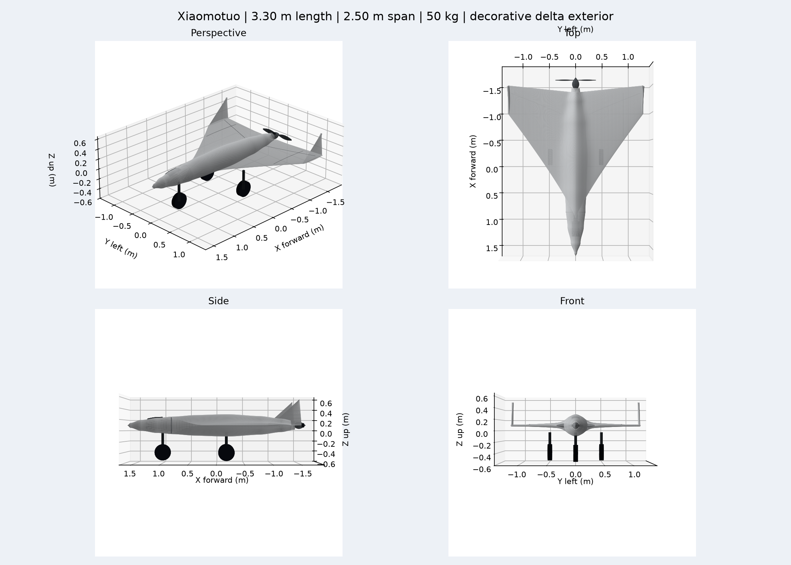

# 小摩托通用固定翼仿真

小摩托采用白色圆润中央外壳、融合三角翼、翼尖竖翼与外观两叶尾桨，显示总长 3.30 m、翼展 2.50 m；通用固定翼仿真总质量 50 kg，采用前三点起落架滑跑起飞和降落。总长包含机头和尾翼突出物，目标最大持续平飞空速为 200 km/h（55.5556 m/s），仿真不模拟电池容量衰减。不含相机或云台。

模型在 PX4 现有 `advanced_plane` 基础上修改，保留 IMU、GPS、气压计、磁强计、AdvancedLiftDrag 气动模型、舵面控制与推进器接口；配有独立美术外壳、50 kg 通用质量/惯性、估计动力与气动参数，以及可滚动三轮起落架。外观参考仅用于美术造型，不用于确定实机结构、制造数据或型号性能。当前网格随组件保存，不配置 LW20 测距仪，不需要下载外部资产。上游模板与 BSD 3-Clause 许可证保存在 `tools/`，来源见 [参数说明](docs/parameters.md)。

外形状态：用户于 2026-10-13 在 Gazebo 确认“现在的造型可以”。确认范围与视觉资源指纹见 [外形验收记录](docs/visual_acceptance.json)。四视图辅助尺寸审阅，实际确认针对 Gazebo 中的当前模型。



运行条件：Gazebo Harmonic、已构建的 PX4 SITL、Python 3；四视图渲染需要 `numpy`/`matplotlib`；飞行测试额外需要 `pymavlink` 和系统 `gz.transport13` / `gz.msgs10` Python 模块。默认 PX4 路径为项目同级 `../PX4-Autopilot`，可用 `PX4_ROOT` 环境变量覆盖。

```bash
# 模型浏览；飞行测试运行世界有50km地面覆盖
sh models/vehicles/xiaomotuo/tests/run.sh view
# PX4 + Gazebo，带 GUI 或无 GUI
sh models/vehicles/xiaomotuo/tests/run.sh sitl
sh models/vehicles/xiaomotuo/tests/run.sh headless
```

启动器在 `/tmp/xiaomotuo.*` 生成独立模型、机体配置、PX4 rootfs 和日志，不修改 PX4 源码。打印的 `GZ_PARTITION` 必须同样传给另一个终端的飞行测试，以订阅 Gazebo 真值；启动输出中的生成参数路径与模型路径供测试记录最终配置。

```bash
GZ_PARTITION=<启动器打印的分区> python3 models/vehicles/xiaomotuo/tests/flight_check.py \
  --config /tmp/xiaomotuo.XXXXXX/models/xiaomotuo/parameters.json \
  --model-dir /tmp/xiaomotuo.XXXXXX/models/xiaomotuo
```

飞行测试使用本地 MAVLink 14540 端口，同一时间只运行一架测试飞机。执行真实 PX4 自动滑跑起飞，随后通过 PX4 姿态控制器保持高度并施加持续最大油门，再上传固定翼进近/降落任务；要求 Gazebo 无风速度、PX4 空速、稳定高度和连续仿真时间满足验收设置，并检查落地自动停机。30 秒是有限验证窗口，不代表续航限制。原始结果写入 `tests/flight_result.json`，交付证据压缩保存在 `tests/results/flight_result.json.gz`，摘要见 `docs/validation.json`，含配置与 SDF 哈希、参数副本、原始遥测和真值。实际通过状态以[验证说明](docs/validation.md)为准。

```bash
python3 models/vehicles/xiaomotuo/tools/generate_model.py
python3 models/vehicles/xiaomotuo/tests/check_model.py
gz sdf -k models/vehicles/xiaomotuo/model.sdf
python3 models/vehicles/xiaomotuo/tools/render_views.py
```

可视几何为平滑白色融合三角翼、圆润中央外壳、翼尖竖翼、装饰面板线和黑色小窗。尾桨仅通过视觉变换安装到通用推进器转轴，起落架独立可视。气动、质量、动力、传感器、舵机和简化碰撞属于通用仿真定义，与美术参考的实机型号没有性能或工程对应关系。碰撞采用通用机身、主翼、尾部盒包络及圆柱轮胎，与可视外壳不完全贴合，未建桨叶碰撞；推力由原生电机插件计算，不由外观网格推导。

初始浏览相机位于 `(5,-6,3) m`，近裁剪为 `0.005 m`、远裁剪 25 km，可在 `tests/world.sdf` 的 GUI 配置修改。机旁定位实体为 `XIAOMOTUO_LOCATION_MARKER`，洋红色立柱位于 `(0,4) m`，黄色箭头指向初始飞机位置；标志无碰撞。`XIAOMOTUO_RUNWAY` 为 +X 方向灰色跑道视觉标记，地面碰撞连续覆盖 50 km，不限定自动验收飞机的落地点。

在实体树选择 `xiaomotuo` 并使用 Camera Tracking 的移动/跟随入口近景观察。滚轮缩放时将鼠标指向飞机实体表面，右键慢拖微调；浏览相机可在 GUI 就绪后调整灵敏度，推荐起始值 `0.1`，也可按场景尺度修改：

```bash
GZ_PARTITION=<运行分区> gz service -s /gui/camera/view_control/sensitivity \
  --reqtype gz.msgs.Double --reptype gz.msgs.Boolean --timeout 3000 --req 'data: 0.1'
```

该服务同时影响缩放、平移、旋转；近裁剪配置只在新建 GUI 场景时生效。飞机无视频相机，浏览参数不会改变 IMU、GPS 或气动。

验收时间保护保存在 `tests/settings.json`：降落阶段允许200仿真秒完成进近、拉平、滑跑减速、落地停机与3秒静止确认。这是测试防挂起设置，不是飞机业务性能限制。
