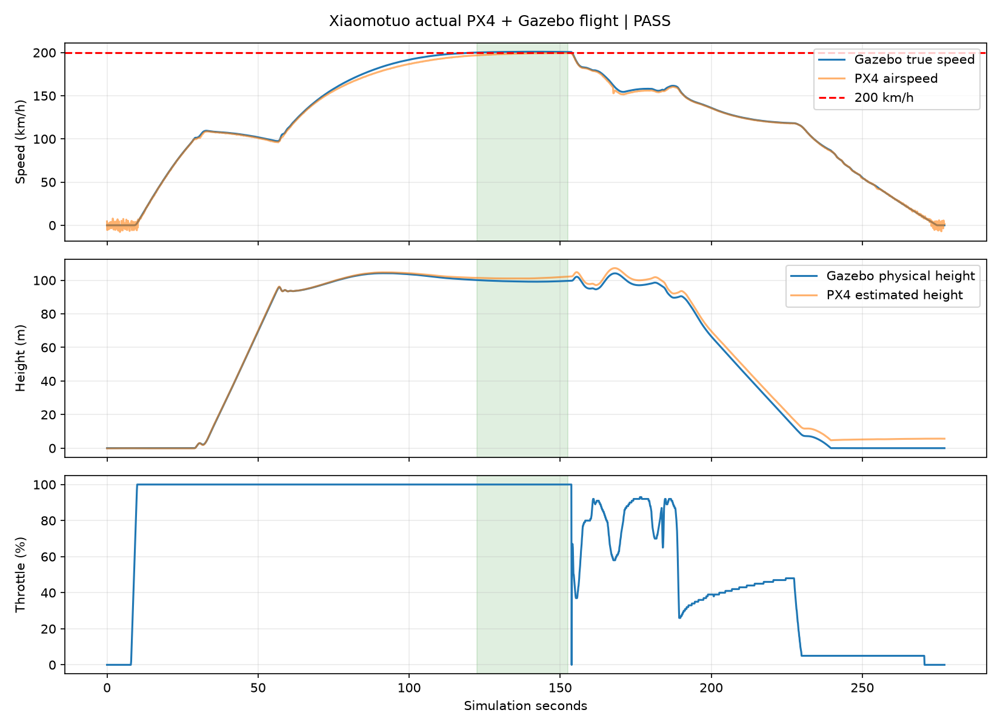

# 验证状态

当前模型、参数、机体配置、默认验收器与测试设置的完整 PX4 + Gazebo 实测通过（`passed=true`）。原始遥测保存在 `tests/results/flight_result.json.gz`，摘要为 `docs/validation.json`，飞行曲线为 `flight_validation.png`；五项当前文件指纹核对及人工确认视觉指纹核对均通过。

用户于 2026-10-13 在 Gazebo 确认当前三角翼外形：“现在的造型可以”。确认范围与网格指纹见 `visual_acceptance.json`。外形是美术近似，气动、质量、动力和碰撞为独立通用仿真定义。

| 实测项目 | 当前结果 |
| --- | --- |
| 自动起飞 | PX4 自动滑跑起飞，爬升至试验高度 |
| 持续最大油门平飞 | 连续 30.096 仿真秒，100% 油门 |
| 无风真值速度 | 200.01～200.96 km/h |
| 100 m 平飞高度误差 | ≤0.834 m |
| 首次接地下降速度 | 1.517 m/s |
| 接地前横滚 | ≤0.076° |
| 接地前俯仰 | 3.927°～3.949° |
| 自动降落与停机 | PX4 任务进近、拉平、三轮接地、滑跑减速及自动停机 |
| 停稳确认 | 真值速度<0.3 m/s、接地、落地状态、已停机连续 3.000 仿真秒 |

验收要求最大油门下真值速度达到目标55.5556 m/s并位于目标至目标102%之间，物理高度误差≤2 m、垂直速度<0.3 m/s，连续覆盖30仿真秒且遥测新鲜。首次接地高度阈值0.10 m、下降速度≤2 m/s；接地前0.8秒下降速度不超过3 m/s、横滚<15°、俯仰(-8°,20°)，之后确认3秒真实静止与停机。200仿真秒降落护栏保存在 `tests/settings.json`，仅用于防止测试挂起。

平飞测试器以 Gazebo 真值作为外层高度反馈，向 PX4 发送姿态与持续100%油门；PX4 原生姿态/角速度控制器驱动舵面。测试器不写入飞机位姿或速度。起飞与任务降落由 PX4 导航器执行。连续30秒为有限验证窗口，不是续航限制；模拟电池保持100%，禁用电压油门缩放。

世界无风，Gazebo运动真值用于速度与物理高度验收。PX4模拟空速按估计器机体前向速度生成，允许目标±1.5 m/s用于交叉检查。平面世界映射至WGS84后，地理高度与物理高度随离原点距离出现曲率差异，任务海拔按位置修正；本轮平飞PX4估高相对物理高度的最大差值为2.518 m，单独记录，不将其混作物理高度误差。

静态检查通过：实际视觉包围盒总长3.3 m、翼展2.5 m，所有link质量合计50 kg，轮子/四个主舵面关节、动力与气动插件、通用尾部碰撞包络存在，尺寸及电机上限重生成检查通过。当前视觉以外的SDF节点与通用模型基线一致。

