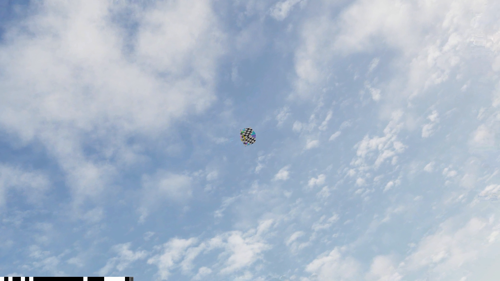
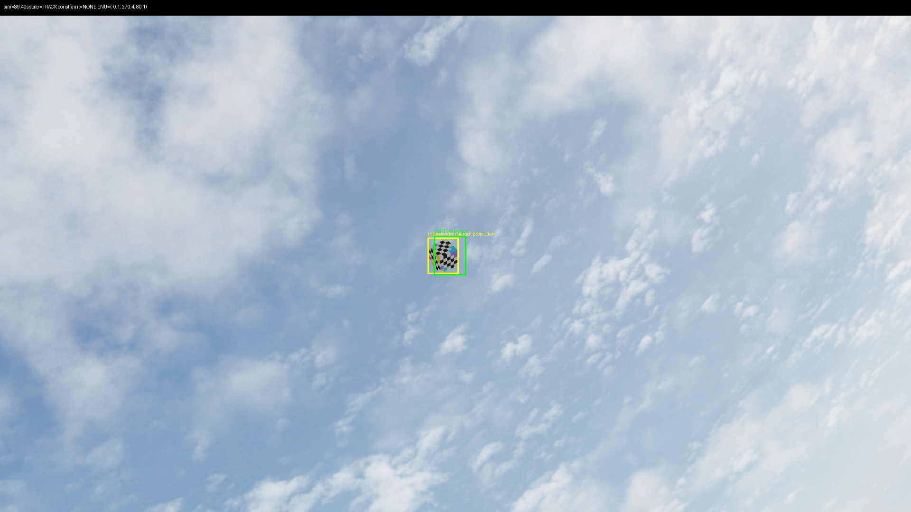
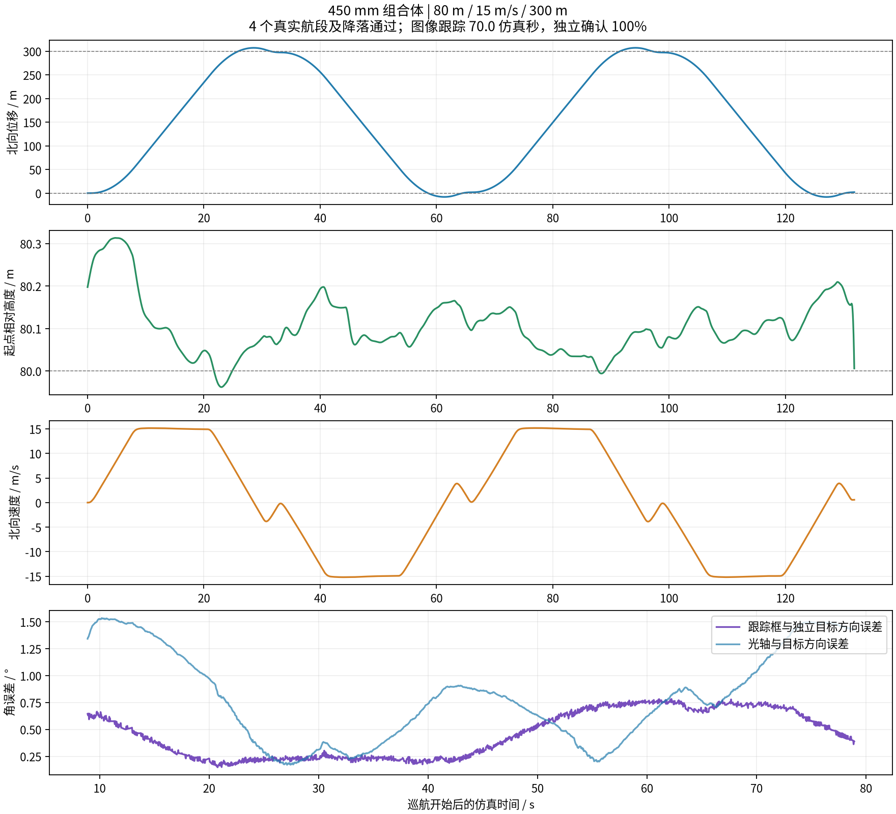

# 组合体地理场景验收记录

当前吊舱使用协议 v7／`motion_head_joint_right_positive`，yaw 绕安装 +X，按镜头视线方向左负右正，运动链为 `Rx(yaw) Ry(-pitch)`，并继承每轴 ±20°/s 机械速度限制。装配继承及离线方向检查已通过；以下整机飞行/跟踪归档需与其运行快照和源指纹一起阅读，不能作为当前配置的验收。当前配置尚未复验整机飞行、快速目标跟踪及完整 RTSP 链路。

归档对应的 **590 mm、5.00 kg、协议 v6／`motion_head_joint`** 组合于 **2026-10-21 20:40:43～20:45:44（Asia/Shanghai）** 完成两次往返、正常降落与停机。该次运行同时取得真实图像跟踪和RTSP身份绑定的独立通过证据，正式归档工具已核验实际运行模型、PX4快照、启动指纹及原始采样。

该次归档场景使用完整地理世界 `geo_32_217857_119_105878` 的运行副本。吊舱底环水平、底座向下、球头一侧朝载机 +X；外轴绕水平 −X、范围±60°，内轴绕随动 −Y、范围−80°～+30°，CAD零位朝安装 +Z，运动链为 `Rx(-yaw) Ry(-pitch)`。安装面z=0.289 m，组合固定零关节名义重心 `(-0.000176261396,-0.000000003426,0.044398504845) m` FLU；CA/EKF位置按此参考派生。

## 实际飞行

PX4使用实际位置反馈执行航迹，Gazebo世界位姿独立检查高度、横向误差、航段端点及速度。设定相对起点高度80 m、航段长度300 m、中部速度15 m/s；有限运行2次往返，共4个真实航段，全部通过，`passed=true`、`landing_confirmed=true`，无验收或降落恢复错误。

起飞前先完成 `ground_reference`：等待10.136仿真秒，最后5秒高度范围0.033022 m、最大绝对垂直速度0.016318 m/s，满足当前0.25 m与0.15 m/s的稳定条件后确定地面参考并起飞。地面参考与航段计分分别记录；相对起点高度不等于沿线各处离地高度。

| 航段 | 最大高度误差／门槛2 m | 最大横向误差／门槛5 m | 端点误差／门槛3 m | 中部平均速度 | 速度±1.5 m/s内比例／要求≥95% |
| --- | --- | --- | --- | --- | --- |
| A→B | 0.115802 m | 0.328767 m | 2.382468 m | 15.260770 m/s | 100% |
| B→A | 0.141089 m | 0.408800 m | 1.696927 m | 15.282974 m/s | 100% |
| A→B | 0.169131 m | 0.434751 m | 2.478757 m | 15.280205 m/s | 100% |
| B→A | 0.180065 m | 0.477731 m | 1.631071 m | 15.270496 m/s | 100% |

完整运行墙钟耗时301.218 s，保留7171条PX4采样、14334条Gazebo真值采样。每航段的计分窗口以原始 `leg_result` 写入点为界，不将随后LAND模式切换等待误计为巡航；飞行曲线采用相同窗口内的原始计分样本，与表格范围一致。

## 真实图像跟踪

纹理靶标 `AERIAL_TRACKING_TARGET` 为世界 ENU `(200,150,280) m` 处的8 m无碰撞立方体。使用一次显式机械对准与视频框选；框选绑定实际匹配的 `frame_seq`。初始化结束后，目标世界坐标只用于独立评分，持续控制由组件CSRT与载机转动补偿完成。

正式观测过程70.028仿真秒，2120个同步评分样本覆盖69.996秒，包含北行、南行及换向。全部2120帧在实际机械可达域内，无退化或限位约束帧。

| 检查 | 既定门槛 | 实测 |
| --- | --- | --- |
| CSRT TRACK比例 | ≥95% | 100% |
| 独立靶标方向与IoU确认比例 | ≥95% | 100% |
| 框中心与独立目标方向误差P95 | ≤3° | 0.516222° |
| 相机光轴与目标方向误差P95 | ≤3° | 1.273050° |
| 遥测图像中心误差P95 | 记录项 | 1.041° |
| 独立重建与遥测光轴差异P95 | ≤1° | 0.123233° |
| 图像相对遥测延迟P95 | ≤0.2 s | 0.040 s |
| 同步帧覆盖率 | ≥90% | 99.9057% |
| 最大观测间隔 | ≤0.5仿真秒 | 0.068仿真秒 |
| 北向／南向累计运动 | 各≥50 m | 393.977 m／309.257 m |
| 北向覆盖跨度 | ≥180 m | 313.275 m |
| 载机姿态变化 | ≥5° | 23.249919° |

实际累计运动711.360 m，丢失帧0、无未声明约束帧。归档工具使用该次冻结的实际评分设置对原始同步样本重新调用 `summarize`，逐项核对结果；没有更改3°、95%、180 m、50 m、5°或40秒最低仿真时长门槛。

## RTSP与身份绑定

实际飞机ID23、吊舱UDP端口8770，视频为 `rtsp://127.0.0.1:8555/two_axis_pod_23`。NVDEC实际拉取143帧，126个唯一视频序号全部有效且全部匹配本次网关遥测帧表，两个比例均为100%，超过既定95%门槛；采集396条遥测、1条hello，身份错误0、时钟域唯一。绑定观测期间遥测均为真实TRACK且目标有效。

ID23路径实际返回200；明确未注册的ID24路径返回404。Station正确ID可用，误配ID24的回零、框选、手动、清故障API均拒绝，实际控制数据报0。错误ID控制调用只接入本地记录socket，不发往飞机。







RTSP图为实际原始解码帧；带框图为跟踪检查保存的实际图像及独立投影标注。视频身份、图像跟踪及飞行原始数据分别核对，不能仅凭画面显示TRACK推断目标锁定正确。

## 归档证据与复核

实际运行目录 `runs/two_axis_geo_full3/`。正式归档包含该次运行30项动态资产源指纹、43项启动前源指纹、5项跟踪源指纹和5项绑定源指纹，用于标识该次运行的源码及资源。启动证据包含实际控制库二进制、飞行脚本、模型和网格；运行配置SHA-256为 `2eedc398dfb48b93101bf912cf10b761a065a29e1a5d31ae830736039c5f7a3c`。实际控制库SHA-256为 `8c817e0cdf119b98e36df8590200d85b99385cd2b066899fe73b0fa78c48a332`。

[完整摘要、设置、航段结果与证据SHA-256](validation.json)包含运行模型快照与源指纹。以下压缩原始证据已入库，不依赖运行目录继续存在：

- [完整飞行报告](../tests/results/combined_flight.json.gz)、[逐步飞行与真值采样](../tests/results/combined_samples.jsonl.gz)
- [跟踪评分摘要与实际设置](../tests/results/tracking_summary.json.gz)、[逐帧独立评分](../tests/results/tracking_samples.jsonl.gz)、[跟踪执行元数据](../tests/results/tracking_execution_metadata.json.gz)
- [RTSP绑定摘要](../tests/results/rtsp_binding_summary.json.gz)、[hello／遥测／实际视频序号](../tests/results/rtsp_binding_samples.jsonl.gz)
- [启动前指纹](../tests/results/execution_fingerprints.json.gz)、[实际运行世界](../tests/results/world.sdf.gz)、[实际动态装配SDF](../tests/results/assembled_model.sdf.gz)

正式复核与归档命令：

```bash
.venv-linux/bin/python scenarios/geographic_rocket_two_axis_pod/report_validation.py \
  --run-dir runs/two_axis_geo_full3 \
  --binding-dir runs/two_axis_geo_full3/rtsp_binding
```

工具先核对模型快照哈希及实际SDF/PX4继承、逐航段原始真值与设置、冻结的启动源指纹、跟踪原始评分、RTSP身份和帧表、观测时间窗口与运行靶标；所有核验、截图读取和曲线生成成功后才写入通过摘要。

## 适用边界

该次归档通过范围是无风地理世界、其对应的5.00 kg组合、指定航线和可达静止空中靶标，覆盖实际发生的23.25°载机姿态变化。两轴不能独立稳定画面滚转，机械限位、速度限制及罩壳遮挡仍适用；不能据此推断任意目标高度、载机姿态或风场下均可锁定。280 m靶标高度是实际机械可达夹具设置，不证明150 m或其他高度目标均可达。

Gazebo浏览相机的定位、近景缩放与人工外形确认仍按[场景说明](../README.md)执行；图像帧率受渲染和主机负载影响，本次采样不构成固定性能保证。[组合完整组件飞行](../../../assembledmodels/rocket_two_axis_pod/docs/validation.md)与[最高稳定速度对照](../../rocket_speed_comparison/docs/validation.md)属于独立范围；本次15 m/s往返不替代最高稳定速度比较。
