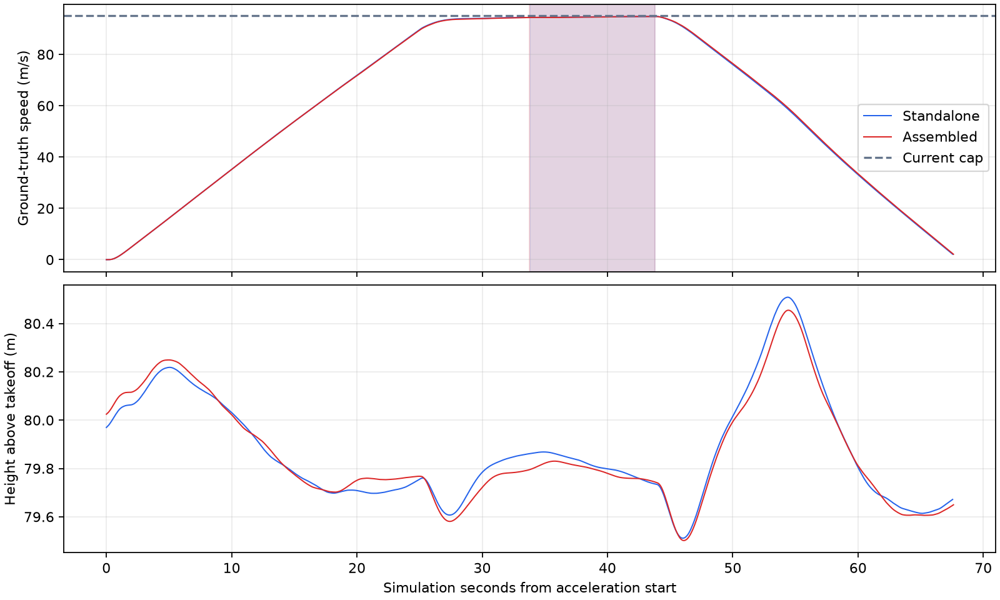

# 当前配置速度对照结果

**在本次1 m/s比较容差下，组合体达到单机的稳定平飞速度水平。** 两架飞机均在当前95 m/s控制上限的设定容差内完成连续10秒稳定平飞、减速和降落；这里没有测定动力极限。

## 实际PX4试飞

| 指标 | 基础火箭单机 | 顶部两轴吊舱组合体 |
|---|---:|---:|
| 总质量 | 1.360000 kg | 1.377556 kg |
| 最高有效稳定窗口平均速度 | 94.5924 m/s | 94.5675 m/s |
| 换算速度 | 340.53 km/h | 340.44 km/h |
| 窗口持续时间 | 10.000仿真秒 | 10.012仿真秒 |
| 窗口速度标准差 | 0.1352 m/s | 0.1384 m/s |
| 窗口最大高度误差 | 0.2642 m | 0.2561 m |
| 加速及保持阶段瞬时峰值 | 94.8324 m/s | 94.7645 m/s |
| 最远水平距离 | 4100.39 m | 4106.29 m |
| 正常减速、落地并解除解锁 | 通过 | 通过 |

组合体稳定速度比单机低0.0249 m/s（约0.09 km/h、0.026%），小于本场景1 m/s比较容差。不能据此把这次单次试飞的微小差值解释为确定的实物性能损失。

两次试飞使用同一个完整地理world、零风、80 m相对起飞高度和同一冻结配置：25仿真秒线性加速，保持95 m/s指令并寻找连续10秒有效窗口。稳定条件为高度误差≤2 m、速度标准差≤0.5 m/s、范围≤2 m/s、拟合及首尾加速度绝对值≤0.2 m/s²，真值间隔≤0.15秒。时间和速度来自Gazebo世界位姿及仿真时间，PX4估计量用于实际闭环控制和健康检查。

阴影为各机型最高有效稳定窗口。两次运行均在4500 m边界前根据实际速度的制动距离加500 m余量结束高速观察，随后正常减速和LAND，结束原因记录为 `test_stop_reason=braking_boundary`。两者满足95 m/s目标的1 m/s容差，速度限制分类为 `control_limited`。最高稳定窗口均值与实际95 m/s指令有小幅差异，不宣称已精确测得95.000 m/s。

## 模型范围

基础模型的解锁怠速为50 rad/s，未解锁时输出0；四电机ESC解锁检查保持启用。基础悬停推力约0.0944385，组合体按实际总质量重新计算为约0.0958234。组合体继承基础模型怠速，场景不覆盖动力、气动或PX4机体参数，也没有额外起飞平台。

当前两者使用相同的电机最大转速1250 rad/s、阻力系数0.73、参考面积0.0177 m²及转子阻力参数。组合体尚未独立建模吊舱造成的额外气动阻力。**结果仅支持当前仿真配置下的速度对照，不能证明实机安装吊舱后没有速度损失。** 电池衰减、风场和桨效率随速度变化也不在当前模型内。

本场景没有启动地面站、视频网关或目标跟踪。相机传感器、吊舱真实关节和控制插件保留在组合机运行模型中；结果不代表高速图像跟踪已经验收。

## 证据与复现

两种机型的角色、场景配置、95 m/s控制上限、规范化环境指纹和场景代码指纹均一致；源资产指纹与当前文件匹配。两个启动器返回0，结果均确认落地停机。

- [比较摘要、模型配置与资产指纹](validation.json)
- [单机原始报告](../tests/results/standalone_trial.json.gz)、[真值与遥测采样](../tests/results/standalone_trial.samples.jsonl.gz)
- [组合体原始报告](../tests/results/assembled_trial.json.gz)、[真值与遥测采样](../tests/results/assembled_trial.samples.jsonl.gz)
- 两次运行的配置、资产清单和PX4/Gazebo/飞行日志也压缩保存在 `tests/results/`，SHA256列在摘要中。

完整运行目录为 `runs/rocket_speed_comparison/validation_current3/`，保留运行世界、生成模型与PX4 ULog。两次仿真实例均已清理。启动及重新生成报告见[场景说明](../README.md)。

离线验证通过：基础火箭6项静态检查、14项飞行辅助回归，组合动态模型检查，以及本场景14项速度窗口与报告防假阳性检查。失败、数据缺口、短峰值、持续加速、机型传错、环境不一致和启动器失败均不能形成通过结论。
